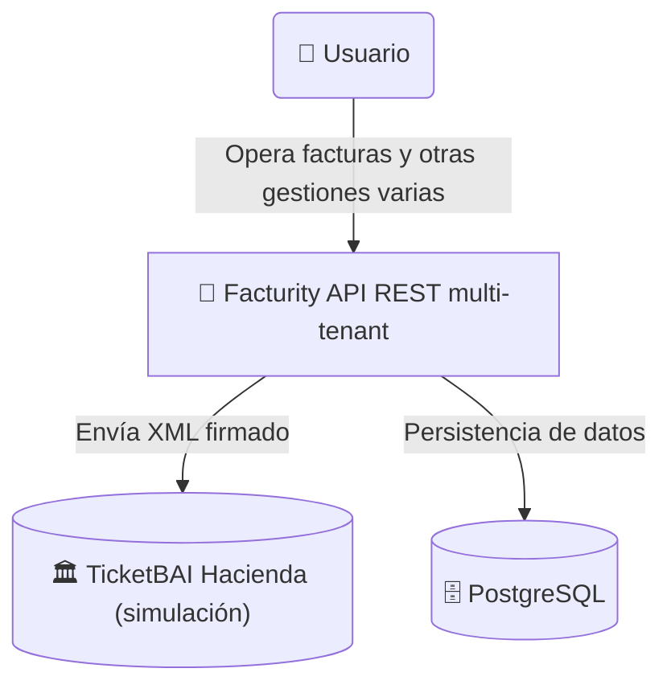

## **Descripción**
**Facturity** es una API REST multi-tenant de gestión de facturación diseñada para cubrir las obligaciones fiscales de cualquier empresa, física o jurídica. Construida con .NET sobre una arquitectura limpia con organización vertical por features y orientada al dominio, expone un conjunto de módulos cohesionados que cubren desde la gestión de clientes y series de facturación hasta la emisión de facturas y el cálculo de impuestos, con soporte nativo para múltiples tenants, trazabilidad completa de operaciones y un sistema de identidad y permisos por tenant.



---
## **Módulos**
### v1
| Módulo | Descripción                                                      |
|-------| ---------------------------------------------------------------- |
| **Auth** | Autenticación JWT, refresh tokens             |
| **Customer** | Gestión de clientes con validaciones y reglas de negocio         |
| **Invoicing** | Emisión, estados, transiciones y numeración correlativa de facturas |
| **TaxEngine** | Cálculo de impuestos configurable y aislado por tenant           |
| **TenantManagement**          | Gestión de tenants                                                               |

### Roadmap
| Módulo                        | Descripción                                                                      |
|-------------------------------|----------------------------------------------------------------------------------|
| **Dashboards**                | Dashboardas, informes y reportes a partir de los datos generados y almacenados.  |
| **Comunicación con Hacienda** | Envío directo de la factura en formato XML válido a la hacienda correspondiente. |

---
## **Funcionalidades**

### v1
- Gestión de clientes
- Gestión de series
- Gestión y consultas avanzadas de facturas
- Generación de XML válido TicketBAI
- Generación de PDF de factura
- Autenticación y autorización, refresh tokens, RBAC
- Auditoría y trazabilidad completa de operaciones

### Roadmap
- Comunicación y envío directo a Hacienda / Diputación Foral de Bizkaia
- Generación de QR obligatorio TicketBAI
- Dashboards y generación de reportes personalizados

---
## **Actores**

### V1
| Actor            | Descripción              | Necesita                                                         |
| ---------------- | ------------------------ | ---------------------------------------------------------------- |
| **Usuario**      | Opera el día a día       | Gestionar clientes, productos y facturas                         |

### Roadmap
| Actor                       | Descripción                       | Necesita                                               |
| --------------------------- | --------------------------------- | ------------------------------------------------------ |
| **Super Admin**  | Administra la plataforma | Gestionar tenants, usuarios y configuración global               |
| **Tenant Admin** | Administra su empresa    | Gestionar usuarios, series, impuestos y configuración del tenant |
| **Usuario de solo lectura** | Acceso externo (contable, gestor) | Consultar facturas e informes sin poder modificar nada |

---
## **Tech Stack**

### Backend
- **Framework:** .NET 10 (LTS)
- **Lenguaje:** C# 14
- **Arquitectura de sistema:** Monolito Modular Evolutivo
- **Arquitectura de software:** Híbrida `Clean Architecture` con`Vertical Slice Architecture` en capa de Features
- **Base de datos:** PostgreSQL 16
- **ORM:** EF Core 10
- **Caché:** Redis

### Patrones y librerías
- **Mapeo**: Mapster
- **Mensajería**: Outbox Pattern (Implementación propia)
- **Validación:** FluentValidation
- **Logging:** Serilog
- **Documentación API**: Scalar

### Testing
- **Unit & Integration:** xUnit, FluentAssertions, Testcontainers
- **Arquitectura:** NetArchTest

### Infraestructura
- **Contenedores:** Docker
- **CI/CD:** GitHub Actions
- **Deploy:** Azure App Service o Azure Container Apps
- **Cloud**: Azure

### Seguridad: 
- **Autenticación:** ASP.NET Core Identity + JWT Access Token y Refresh Tokens (Implementación propia)
- **Autorización:** Permisos por tenant

---
### Roadmap técnico
- MassTransit + Azure Service Bus 
- Usuario de solo lectura 
- Generación de QR TicketBAI 
- Generación de PDF de factura 
- Comunicación y envío directo a Hacienda

## **Estructura de la solución**

```text
Facturity/
├── src/
│   ├── Host/
│   │   └── Facturity.API/
│   ├── Modules/
│   │   ├── [module_x]/
│   │   │   ├── Facturity.Modules.[module_x]
|   |   |   |   |
|   |   |   |   ├── Domain/
|   |   |   |   ├── Features/
|   |   |   |   ├── Infrastructure/
│   │   │   └── ...
│   │	├── Facturity.Modules.Bootstrapper
│   │	└── Facturity.Modules.SharedKernel
├── tests/
│   ├── Modules/
│   │   ├── [module_x]/
|   |   |   └──Facturity.Modules.[module_x].UnitTests
│   │   └── ...
│   ├── Facturity.IntegrationTests/
│   │   ├── [module_x]/
│   │   └── ...
│   └── Facturity.ArchitectureTests/
├── docs/
├── docker-compose.yml
├── README.md
└── Facturity.slnx
```