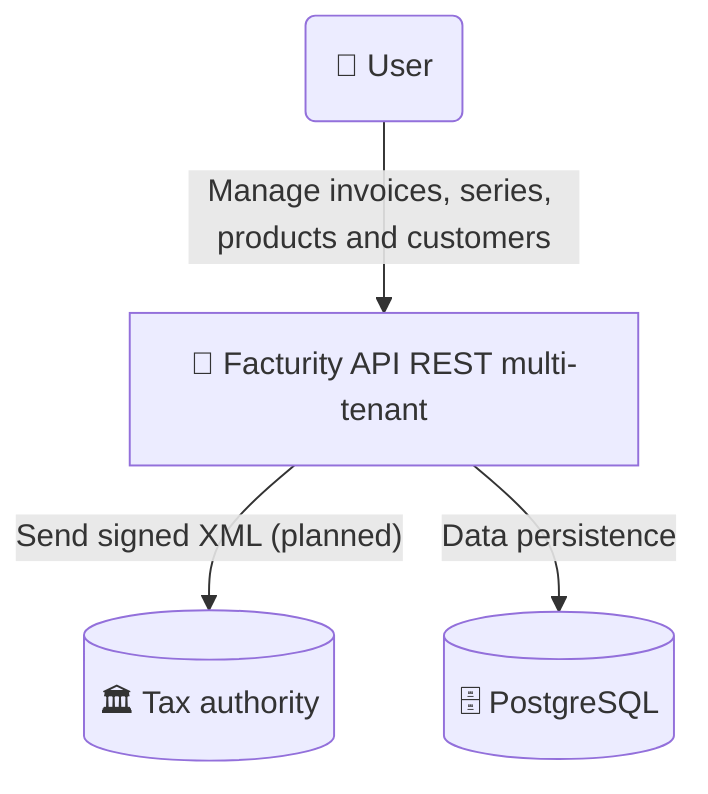

# Facturity

[](https://github.com/Enekoitz/Facturity/actions/workflows/ci.yaml)


> **Status:** v1 under active development. This is a portfolio project.

## **Description**
**Facturity** is a multi-tenant REST API for invoicing management, designed to address the tax compliance requirements of any business, whether an individual or a legal entity. It is a modular monolith built with .NET 10 Minimal API, where each module follows a hybrid and pragmatic architecture: Clean Architecture combined with Vertical Slice Architecture for feature organization. It provides a set of cohesive modules that cover everything from customer management and invoice numbering sequences to invoice issuance and tax calculation. It includes native support for multiple tenants, full operational traceability, and a tenant-specific identity and permissions system.



---
## **Modules**
### v1
| Module | Description |
|--------|-------------|
| **Auth** | JWT authentication, refresh tokens |
| **Customer** | Customer management with validations and business rules |
| **Product** | Products management |
| **Invoicing** | Issuing, statuses, transitions and sequential numbering of invoices |
| **TenantManagement** | Tenant management |

### Roadmap
| Module | Description |
|--------|-------------|
| **Dashboards** | Dashboards, reports and analytics built from the generated and stored data. |
| **TaxAuthorityIntegration** | Direct submission of the invoice in valid XML format to the relevant tax authority (Hacienda, the Spanish Tax Agency). |

---
## **Features**

### v1
- Customer management
- Invoice series management
- Invoice management and advanced queries
- Authentication and authorization, refresh tokens, RBAC
- Tenant management

### Roadmap
- Invoice PDF generation
- Valid TicketBAI XML generation
- Full auditing and traceability of operations
- Direct submission to the Provincial Tax Authority of Bizkaia (Diputación Foral de Bizkaia)
- Mandatory TicketBAI QR code generation
- Dashboards and custom report generation

---
## **Actors**

### v1
| Actor | Description | Needs |
|-------|-------------|-------|
| **User** | Handles day-to-day operations | Manage customers, products and invoices |

### Roadmap
| Actor | Description | Needs |
|-------|-------------|-------|
| **Super Admin** | Manages the platform | Manage tenants, users and global configuration |
| **Tenant Admin** | Manages their company | Manage users, series, taxes and tenant configuration |
| **Read-only user** | External access (accountant, tax advisor) | View invoices and reports without being able to modify anything |

---
## **Tech Stack**

### Backend
- **Framework:** .NET 10 (LTS)
- **Language:** C# 14
- **System architecture:** Modular Monolith
- **Software architecture:** Hybrid `Clean Architecture` with `Vertical Slice Architecture` in the Features layer
- **Database:** PostgreSQL 16
- **ORM:** EF Core 10
- **Cache:** Redis

### Patterns and libraries
- **Messaging:** Outbox Pattern (custom implementation) (ROADMAP)
- **Validation:** FluentValidation
- **Logging:** Serilog
- **API documentation:** Scalar

### Testing
- **Unit & Integration:** xUnit, FluentAssertions, Testcontainers
- **Architecture:** NetArchTest

### Infrastructure
- **Containers:** Docker
- **CI/CD:** GitHub Actions
- **Deploy:** Azure App Service or Azure Container Apps
- **Cloud:** Azure

### Security
- **Authentication:** ASP.NET Core Identity + JWT access tokens and refresh tokens (custom implementation)
- **Authorization:** Per-tenant permissions

---
### Technical Roadmap
- MassTransit + Azure Service Bus
- Read-only user
- TicketBAI QR code generation
- Invoice PDF generation
- Direct submission to Hacienda

---
## **Getting Started**

### Prerequisites
- .NET 10 SDK
- Docker (PostgreSQL, Redis and Testcontainers for the integration tests)
- *(Optional)* [Seq](https://datalust.co/seq) for structured log visualization

### 1. Clone the repository
```bash
git clone https://github.com/Enekoitz/Facturity.git
cd Facturity
```

### 2. Configure secrets
The repository contains **no secrets**. For local development use [.NET User Secrets](https://learn.microsoft.com/aspnet/core/security/app-secrets):

```bash
cd src/Host/Facturity.API
dotnet user-secrets init
dotnet user-secrets set "ConnectionStrings:FacturityDbConnectionString" "Host=localhost;Port=5432;Database=facturity;Username=postgres;Password=<your-password>"
dotnet user-secrets set "Jwt:SigningKey" "<random-string-of-at-least-32-chars>"
```

To generate a signing key: `openssl rand -base64 64`

### 3. Start the infrastructure
```bash
cp .env.example .env     # set your own values
docker compose up -d
```

### 4. Apply migrations and run
```bash
dotnet ef database update \
  --project src/Modules/Auth/Facturity.Modules.Auth \
  --startup-project src/Host/Facturity.API \
  --context AuthDbContext

dotnet ef database update \
  --project src/Modules/Customer/Facturity.Modules.Customer \
  --startup-project src/Host/Facturity.API \
  --context CustomerDbContext

dotnet run --project src/Host/Facturity.API
```

### 5. Explore the API
Interactive documentation (Scalar) is available at `http://localhost:<port>/scalar`.

---
## **Configuration**

| Key | Description | Required |
|-----|-------------|----------|
| `ConnectionStrings:FacturityDbConnectionString` | PostgreSQL connection string | Yes |
| `Jwt:SigningKey` | Signing key for access tokens (min. 32 chars) | Yes |
| `Jwt:Issuer` / `Jwt:Audience` | Token issuer and audience | No (defaults in `appsettings.json`) |
| `Jwt:ExpirationMinutes` | Access token lifetime (default: 15) | No |
| `RefreshToken:ExpirationDays` | Refresh token lifetime (default: 21) | No |
| `Serilog:...:apiKey` | Seq API key | No |

Outside of development, pass these values as environment variables, using `__` as the nesting separator (e.g. `Jwt__SigningKey`).

---
## **Running the tests**

```bash
dotnet test
```

| Suite | Description |
|-------|-------------|
| `Facturity.<module-name>.UnitTests` | Domain and feature logic per module |
| `Facturity.IntegrationTests` | End-to-end through the API with a real PostgreSQL (Testcontainers, requires Docker) |
| `Facturity.ArchitectureTests` | Enforces architectural rules (NetArchTest) |

---
## **Solution Structure**

```text
Facturity/
├── src/
│   ├── Host/
│   │   └── Facturity.API/
│   └── Modules/
│       ├── [module_x]/
│       │   └── Facturity.Modules.[module_x]/
│       │       ├── Domain/
│       │       ├── Features/
│       │       └── Infrastructure/
│       ├── ...
│       ├── Facturity.Modules.Bootstrapper/
│       └── Facturity.Modules.SharedKernel/
├── tests/
│   ├── Modules/
│   │   ├── [module_x]/
│   │   │   └── Facturity.Modules.[module_x].UnitTests/
│   │   └── ...
│   ├── Facturity.IntegrationTests/
│   │   ├── [module_x]/
│   │   └── ...
│   └── Facturity.ArchitectureTests/
├── docs/
├── compose.yml
├── README.md
└── Facturity.slnx
```

---
## **CI/CD**

- **CI (GitHub Actions):** build and test on every pull request and push to `main`.
- **CD:** planned, deployment to Azure *(roadmap)*.

---
## **Feedback and contributions**

This is a personal portfolio project, so **pull requests are not accepted**. Comments and suggestions are welcome through issues or by contacting me directly.

---
## **License**

Copyright (c) 2026 Enekoitz Bilbao. All rights reserved.
The source code is for portfolio purposes only. See [LICENSE](LICENSE).

---
## **Author**

**Enekoitz Bilbao**: [LinkedIn](https://www.linkedin.com/in/ebilbaocaicedo/) / ebilbaocaicedo@gmail.com
