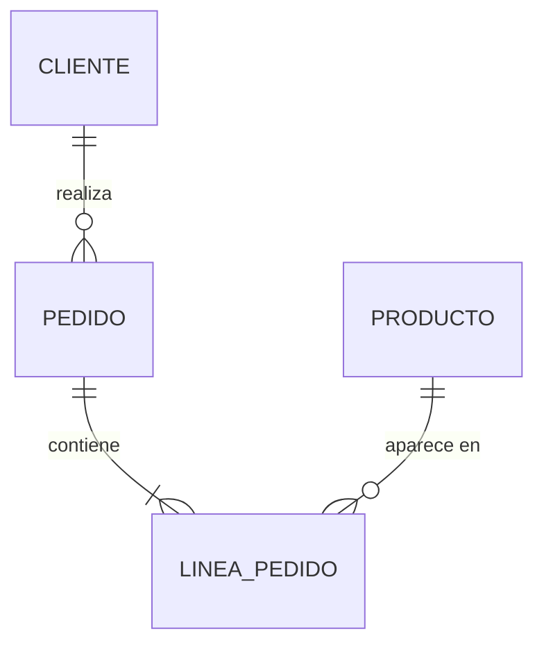

# Modelo de dominio

> **Propósito:** las entidades del negocio, sus relaciones y reglas. Parte de los sustantivos del [glosario](glossary.md) y de las historias.
>
> **Preguntas guía:** ¿Qué conceptos existen? ¿Cómo se relacionan? ¿Qué reglas se cumplen siempre (invariantes)? ¿Qué ciclo de vida tiene cada entidad?

## Diagrama

_Sustituye este ejemplo. Si prefieres clases, usa `classDiagram`._

## Entidades
| Entidad | Descripción | Atributos clave |
|---|---|---|
| | | |

## Reglas de negocio e invariantes
_Lo que no se ve en el diagrama._

-

## Ciclo de vida / estados
_Si alguna entidad tiene estados, descríbelos (puedes usar `stateDiagram-v2`)._

---
_Última revisión: AAAA-MM-DD_
